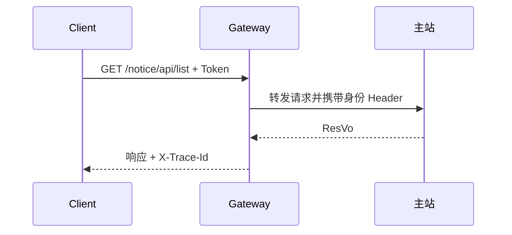
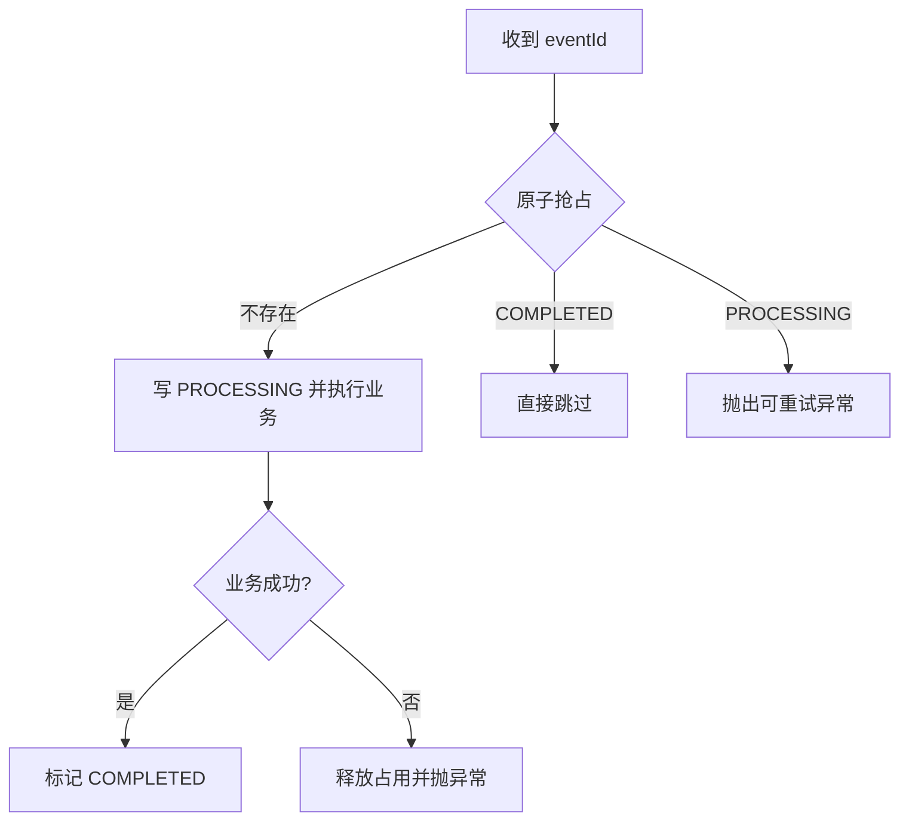

# 原生阅读测试

这份文件只用于原生外壳测试。

> 这是一段用于验证 PDF 导出的长引用。导出后的正文必须完整展开，不应出现阅读界面的滚动条，也不能把引用后半段截断。
> 重复内容用于让引用高度超过旧版的限制：架构说明、核心代码、设计原因、故障边界、验证结果和面试口径都应完整保留。
> 即使引用内容跨越多行或接近分页边界，PDF 也应按照纸张分页，而不是生成一个可滚动的小窗口。

## 阅读和编辑

支持 **Markdown**、`代码` 和笔记。
