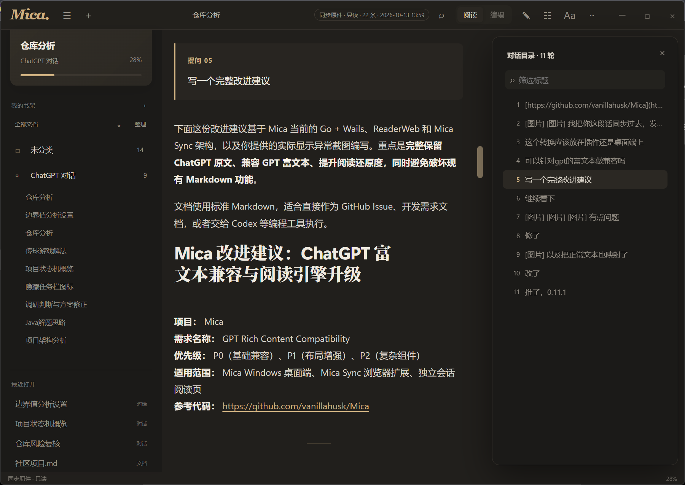
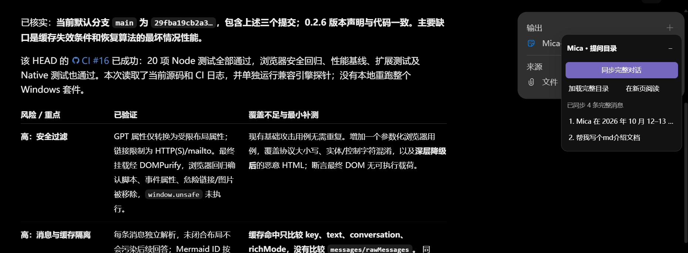
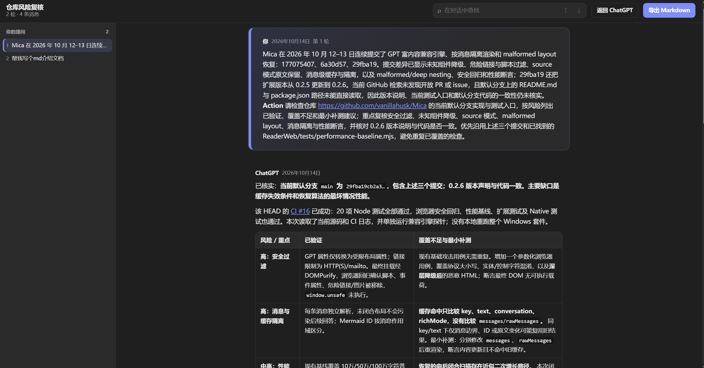

# Mica

[](LICENSE)

> 找回值得重读的内容。

Mica 是一款轻量、安静的 Windows 阅读器，把 Markdown、PDF、常见文本和 ChatGPT 对话放进同一个本地书架。免安装，不依赖 .NET Desktop Runtime。



## 为什么是 Mica

- **专注阅读**：出版物式排版、目录、全局搜索、主题与阅读位置恢复。
- **技术内容友好**：支持 Mermaid、公式、代码高亮、表格、图片缩放和 PDF 导出。
- **本地资料库**：打开文件、批量文件或文件夹，也可直接拖入；支持分类、图谱、高亮、标签与笔记。
- **重读 ChatGPT**：Mica Sync 保存完整会话，按每次提问导航，并还原常见 GPT 富文本。
- **隐私优先**：文档、会话和笔记保存在本机，不经过 Mica 服务器。

## ChatGPT 会话，也值得好好阅读

Mica Sync 会实时跟随当前 ChatGPT 对话；同步后可在 Mica 中按问题浏览，也可打开独立阅读页。

<table>
  <tr>
    <td width="50%"></td>
    <td width="50%"></td>
  </tr>
  <tr>
    <td align="center">网页内实时同步</td>
    <td align="center">完整会话阅读与导出</td>
  </tr>
</table>

## 下载与使用

前往 [GitHub Releases](https://github.com/vanillahusk/Mica/releases) 下载：

- `Mica-*-win-x64.zip`：解压后运行 `Mica.exe`。
- `Mica-Sync-*-chrome.zip`：可选扩展，在 Chrome/Edge 的扩展管理页选择“加载已解压的扩展”。

点击 Mica 的“打开”可选择一个文件、多个文件或文件夹；需要同步 ChatGPT 时，进入 **更多 → 连接 ChatGPT**，按界面提示完成连接。

> 支持 Windows 10/11 x64，需要 WebView2（多数系统已自带）。数据默认位于 `%LOCALAPPDATA%\Mica`。

## 从源码构建

开发环境需要 Windows、Go 和 Node.js 24；普通用户不需要安装这些工具。

```powershell
cd ReaderWeb
pnpm install --frozen-lockfile
cd ../BrowserExtension
pnpm install --frozen-lockfile
cd ../Native
node build.mjs
go test ./...
node native-build.mjs
```

生成文件为 `Native/Mica.exe`。桌面端源码在 [`Native`](Native)，渲染器在 [`ReaderWeb`](ReaderWeb)，浏览器扩展在 [`BrowserExtension`](BrowserExtension)。旧 WPF 0.8.1 仅保留在 `legacy/wpf-0.8.1` 分支。

## 许可证

Mica 以 [MIT License](LICENSE) 开源。第三方组件保留各自的许可证与版权声明，扩展相关说明见 [THIRD-PARTY-NOTICES](BrowserExtension/THIRD-PARTY-NOTICES.txt)。
