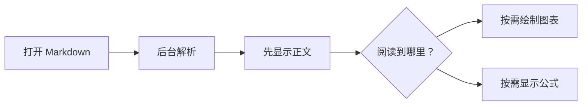
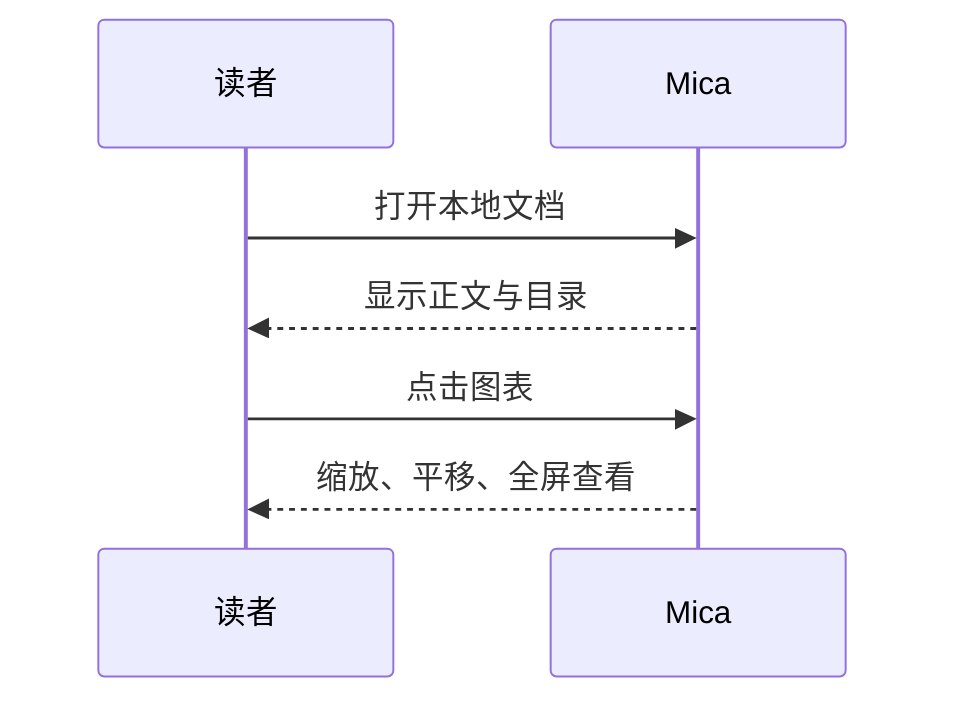

# 安静地读，清楚地看

这是一份 Mica 阅读能力示例。右侧目录可以定位章节；打开图表后，用滚轮缩放、鼠标拖动平移，或点击 **全屏 / 新窗口**。

> [!TIP]
> 阅读时保持正文干净，需要时再打开书架、目录和图表工具。

## 从文字到图表





## 代码需要清晰的颜色

```java
public class Reader {
    // 让内容成为主角
    private final String name = "Mica";

    public String welcome() {
        return "Keep reading.";
    }
}
```

行内代码 `String name = "Mica"` 与正文区分，但不过分抢眼。

## 数学与公式

行内公式 $E = mc^2$，以及块级公式：

$$
\int_0^1 x^2\,dx = \frac{1}{3}
$$

\[
\begin{bmatrix} a & b \\ c & d \end{bmatrix}
\]

## 常见 Markdown 内容

| 能力 | 状态 | 操作 |
| :--- | :---: | ---: |
| 图表查看 | 支持 | 点击图表 |
| 代码复制 | 支持 | 点击复制代码 |
| 图片放大 | 支持 | 点击图片 |

- [x] 表格对齐、任务列表
- [x] ~~删除线~~、==高亮==、H~2~O、x^2^
- [x] 引用链接与脚注[^reading]

1. 阅读一段文字
   - 理解上下文
   - 查看代码与示意图
2. 用目录回到重点

Markdown
: 一种适合阅读与写作的轻量标记格式。

<details>
<summary>展开一条补充说明</summary>

折叠区里的 **Markdown** 同样可以阅读。

</details>

> [!NOTE]
> 相对图片路径以文档目录为起点；图表和公式引擎无需联网。

[^reading]: 让工具退到后面，让内容留在眼前。
